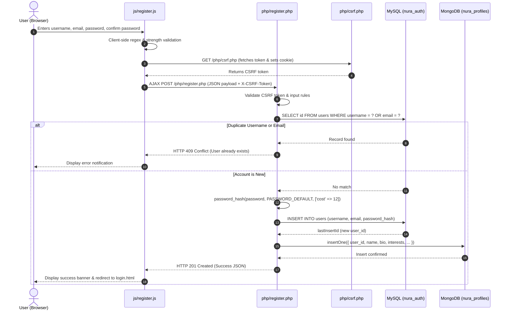
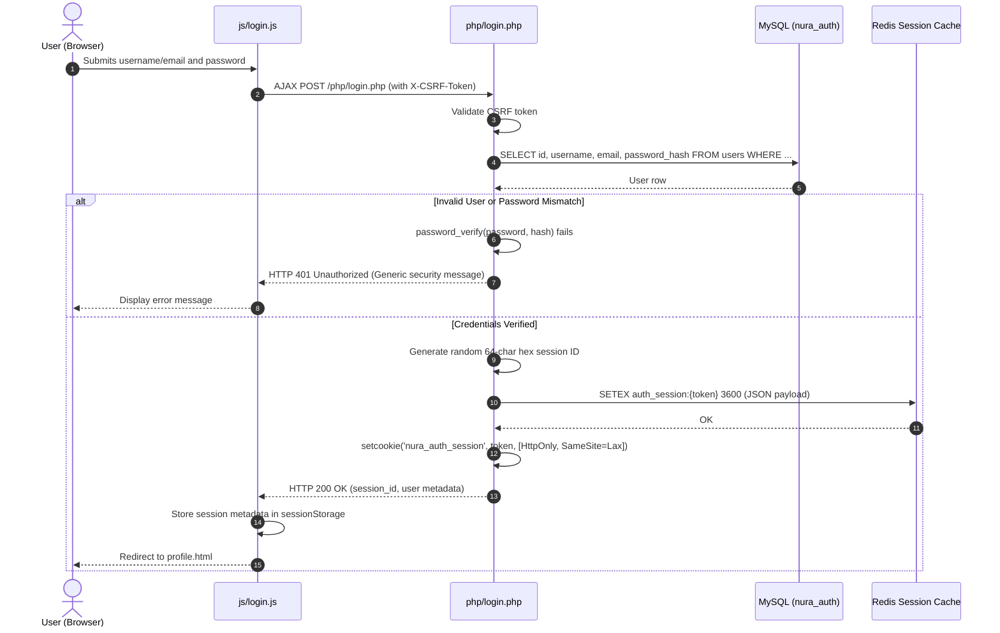
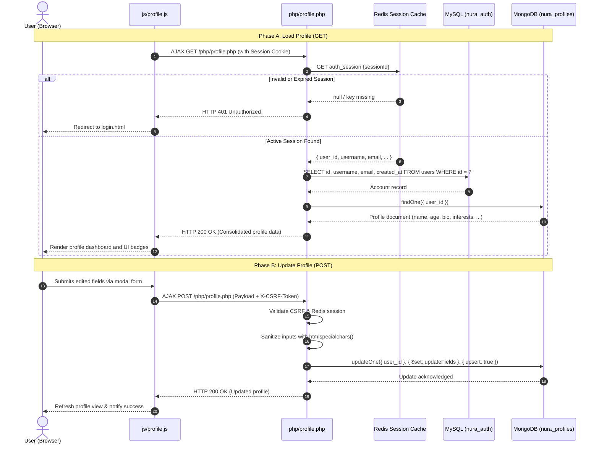
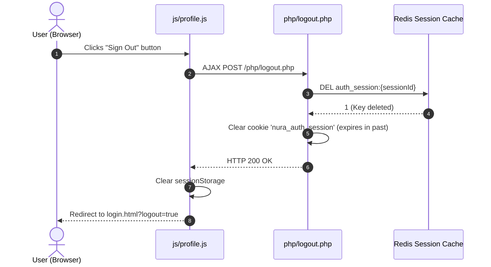

# NURA AI LABS - Application Workflows & Sequence Flows

This document details the lifecycle workflows for User Registration, Authentication/Login, Profile Retrieval & Mutation, and Session Invalidation (Logout).

---

## 1. User Registration Flow

---

## 2. User Authentication & Login Flow

---

## 3. Profile Retrieval & Update Flow

---

## 4. User Logout & Session Termination Flow

