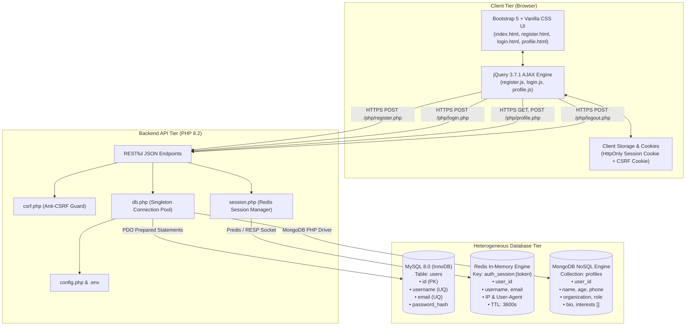

# NURA AI LABS - Multi-Tier Authentication Architecture

## 1. System Overview

The NURA AI Labs Authentication Platform is engineered using a **heterogeneous multi-tier storage paradigm**. Rather than relying on a single database for all workload types, the system strategically bifurcates concerns across three specialized datastores:

1. **MySQL 8.0 (ACID Relational Core)**: Manages strict identity records, unique constraints (`username`, `email`), and BCrypt cryptographic password hashes.
2. **Redis In-Memory Key-Value Store**: Serves as a high-speed, sub-millisecond session state cache with automated time-to-live (TTL) expiration, immune to database bottlenecks.
3. **MongoDB Document Store**: Handles unstructured and polymorphic user profile metadata, research interests, and biographical data without requiring relational schema migrations.

---

## 2. End-to-End System Architecture Diagram

---

## 3. Security Architecture & Threat Mitigations

| Threat Vector | Mitigation Strategy Implemented in Nura AI Labs |
| :--- | :--- |
| **SQL Injection** | Exclusively uses PDO prepared statements with parameterized queries (`PDO::ATTR_EMULATE_PREPARES => false`). |
| **Cross-Site Request Forgery (CSRF)** | Double-submit cookie with cryptographic 64-char hex token validation via `X-CSRF-Token` headers. |
| **Cross-Site Scripting (XSS)** | All user inputs are sanitized with `htmlspecialchars(..., ENT_QUOTES, 'UTF-8')` before document storage. |
| **Session Fixation** | Every login produces a newly synthesized cryptographically secure 256-bit token via `random_bytes(32)`. |
| **Session Hijacking** | Cookie configured with `HttpOnly` (inaccessible via JavaScript) and `SameSite=Lax` (configurable to `Strict` and `Secure`). |
| **Credential Enumeration** | Constant-time execution and generic error messaging (`Invalid username/email or password`) across login attempts. |
| **Credential Leakage** | All database connection strings and passwords strictly managed via `.env` and loaded securely through `vlucas/phpdotenv`. |
